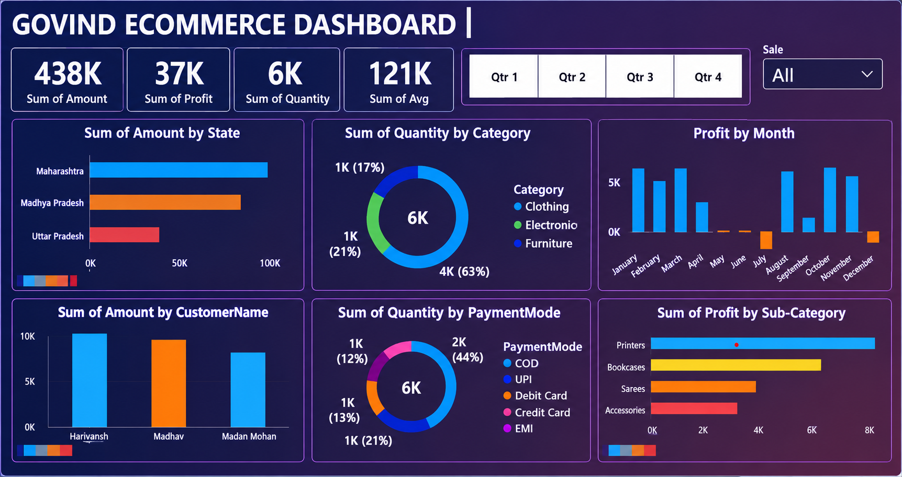

# Govind E-commerce Dashboard | Power BI

## About
An interactive E-commerce Sales Dashboard created using Microsoft Power BI to analyze sales, profit, quantity, customer performance, payment methods, and product categories.

## Tools Used
- Microsoft Power BI

## Dashboard Preview

## Dashboard Features
- Sales amount analysis
- Total profit and monthly profit analysis
- State-wise sales comparison
- Category-wise quantity analysis
- Customer-wise sales analysis
- Payment mode analysis
- Sub-category profit analysis
- Quarterly filtering (Qtr 1, Qtr 2, Qtr 3, Qtr 4)

## Key Metrics
- **Total Sales Amount:** 438K
- **Total Profit:** 37K
- **Total Quantity:** 6K
- **Sum of Average:** 121K

## How to View
1. Download the `.pbix` file from this repository.
2. Open it using Microsoft Power BI Desktop.
3. Explore the interactive dashboard and its filters.

The dashboard screenshot can be viewed directly on GitHub without installing Power BI.

## Author
**Govind Kumar**

Aspiring Data Analyst
